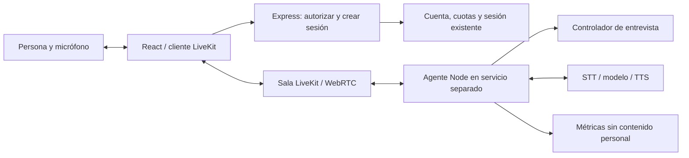

# Evaluación de voz continua con LiveKit

Evaluación del 12 de octubre de 2026. No instala LiveKit, no activa servicios
de pago y no verifica una llamada real. Conserva los cambios de conversación
guiada preparados anteriormente.

## Decisión recomendada

Preparar un piloto con **LiveKit Cloud + LiveKit Agents para Node.js**, usando
una cadena separada de transcripción en streaming, modelo de texto y síntesis.
Reutilizar el controlador de entrevistas de CitizenshipAI. Empezar con audio
y los videos actuales de Sarah/Kevin; evaluar el avatar sincronizado después.

El servidor y el starter oficial ya usan Node 24. No hace falta migrar la app
a Python. El registro npm devuelve 1.9.2 para Agents y los plugins LiveKit/OpenAI,
y 2.22.4 para el cliente web. Son candidatos para un piloto con versiones fijadas,
no dependencias instaladas ni una combinación validada en este repositorio.

LiveKit resuelve transporte y turnos de voz. No incluye un motor de entrevistas
migratorias validado ni evita repeticiones por sí solo: eso sigue siendo
responsabilidad del controlador de la aplicación.

## Qué cambia para la persona

1. Elige tema, español/inglés y Sarah/Kevin; concede el micrófono al conectar.
2. El personaje pregunta y el micrófono permanece abierto durante la sesión.
3. La persona contesta sin pulsar Terminar. El detector de voz detecta actividad
   y el detector semántico estima cuándo terminó el turno, usando la transcripción.
4. Si la persona continúa después de una pausa breve, el agente espera.
   Si empieza a hablar mientras el agente habla, se puede interrumpir el audio.
5. «Repite», «no sé», «quiero corregir», «siguiente», pausa y salida son acciones
   del controlador. El silencio no se convierte en una respuesta incorrecta.
6. Micrófono apagado, escribir y desconectar permanecen disponibles. Salir
   termina las pistas de audio y el trabajo del agente; no basta ocultar la vista.

El idioma elegido se aplica a STT, instrucciones, preguntas y TTS. No se cambia
automáticamente por el tema ni por el acento. Ciudadanía ofrece práctica de
inglés sin imponerlo; asilo/ajuste pueden empezar en español. La primera versión
se valida en EN/ES; otros idiomas requieren comprobación de todos los proveedores.

## Arquitectura para la app existente

- React incorpora el cliente de sala dentro de ConversationPractice. Los estados
  escuchando/pensando/hablando llegan del agente; no se deducen de un temporizador.
  El sonido remoto reemplaza speakAppText durante la sesión LiveKit para evitar
  dos voces, eco o grabar al propio personaje. Los videos existentes responden
  al estado de habla, sin prometer sincronización de labios.
- Express conserva autenticación, promoción, límites y reservas de sesiones.
  Un endpoint propuesto POST /voice/session recibe tema, idioma, personaje y
  sesión autorizada; valida esos datos y emite un token limitado a una sala,
  identidad y permisos de audio. Las claves privadas no llegan al navegador.
- El agente se ejecuta en un proceso/servicio persistente separado. Inicializa
  modelos antes de atender sesiones, se conecta a la sala y recibe solo la
  configuración validada por el servidor. No confiar en metadatos enviados por
  el navegador para decidir cuotas, usuario o autorización.
- Se puede alojar el agente en LiveKit Cloud o en un worker propio. La API
  Render actual no debería ejecutar trabajos de voz dentro de peticiones HTTP
  ni asumir que un servicio con suspensión puede sostener conversaciones.
- Cloudflare Pages sigue sirviendo la web y el proxy HTTP sigue sirviendo
  autorización/configuración. El flujo WebRTC se conecta directamente a LiveKit;
  no se transporta mediante functions/api/[[path]].js.

## Control de entrevista y recuperaciones

Usar el hook de turno completado del agente y las funciones de conversationFlow,
n400InterviewEngine y el evaluador cívico. Solo una transcripción final aceptada
puede producir una transición; las parciales actualizan subtítulos.

Estado propuesto por sesión: idioma, personaje, tema/etapa, pregunta actual,
conceptos tratados, respuestas de trabajo, número de aclaraciones, versión del
turno, respuesta en reproducción y estado de conexión. Todo vive en el worker
salvo los datos que la persona decida confirmar mediante el mecanismo existente.

- Los eventos repetidos se deduplican con identidad de turno y versión de estado.
- El modelo ayuda a entender o dar comentarios; una salida validada propone
  responder/aclarar/omitir/corregir. El controlador autoriza el avance y selecciona
  una pregunta relevante que no esté completada. No ejecutar directamente una
  instrucción del usuario como herramienta privilegiada.
- Corregir una respuesta modifica el turno indicado, sin asumir que era respuesta
  a la siguiente pregunta. Una interrupción no completa automáticamente un tema.
- Una aclaración útil por respuesta ambigua; luego ofrecer continuar/omitir,
  conservando desconocido. No interpretar incertidumbre como No.
- En civismo, conservar el banco oficial y la evaluación local determinista.
  La transcripción puede usar IA; la calificación cívica nunca se delega al modelo.
- Fallo de transcripción: conservar pregunta, ofrecer escribir/reintentar.
  Fallo de LLM/TTS: evitar generar otro turno; ofrecer la alternativa existente.
  Reconexión: reutilizar sesión y estado, sin nueva reserva ni volver a saludar
  y reiniciar preguntas. Si el worker perdió estado, pedir reanudar explícitamente;
  no fingir que recuperó respuestas.
- El SDK permite interrupciones por VAD y recuperación de falsas interrupciones.
  Ajustar esos parámetros con ruido real, asentimientos breves y EN/ES.
  La detección semántica ayuda, pero no garantiza que jamás interrumpirá.

La agenda guiada actual de seis temas puede servir para el primer piloto técnico.
Para una entrevista más profunda habrá que ampliar el contenido y las reglas
contextuales por dominio. Instalar LiveKit no convierte esos seis ejercicios en
una entrevista oficial de asilo, ajuste o ciudadanía.

## Cadena de voz recomendada

| Pieza | Primer piloto |
| --- | --- |
| Transporte | LiveKit Cloud / WebRTC, con reconexión y fallback por TCP/TURN según el servicio |
| Actividad de voz | Silero VAD, precargado en el worker |
| Fin de turno | Detector multilingüe LiveKit, con artefacto/revisión fijados y EN/ES verificados |
| Transcripción | Modelo STT que anuncie streaming real, con idioma explícito y pruebas de acento |
| Respuesta | Modelo de texto con instrucciones y memoria acotada, gobernado por el controlador |
| Síntesis | TTS de baja latencia con voces EN/ES diferenciadas y probadas para ambos personajes |

No basta mover el upload actual de /transcribe al agente: el modelo/plugin elegido
debe admitir streaming. Algunos adaptadores convierten un proveedor por lotes
en una interfaz de streaming, pero eso conserva parte de la espera. El código
consultado contiene tanto STT realtime como adaptadores de proveedores; se debe
fijar el modelo exacto tras medirlo. Tampoco basta conservar el TTS del navegador
para tener el historial de audio interrumpido coherente con el agente.

Se recomienda esta cadena frente a voz-a-voz directa para el primer piloto porque
permite inspeccionar y controlar los turnos, reutilizar la calificación cívica y
separar cambios de voz/modelo. La opción realtime voz-a-voz puede compararse
después en latencia, coste, control y capacidad de recuperar interrupciones.

## Despliegue, secretos y coste

Requisitos que aún no existen en este entorno:

- Proyecto LiveKit, URL WebSocket y claves LIVEKIT_API_KEY / LIVEKIT_API_SECRET.
- Worker de agentes desplegado con TLS, acceso a LiveKit y a los proveedores.
- Credenciales STT/LLM/TTS, o configuración de LiveKit Inference que permita
  utilizar proveedores mediante el proyecto. Los modelos y voces del starter
  son ejemplos, no se deben copiar sin verificar disponibilidad y precios.
- Modelos descargados durante el build. El detector consultado utiliza ONNX en
  CPU y artefactos de Hugging Face; presupuesto de RAM/concurrencia por medir.
  El framework Apache-2.0 y la licencia del modelo de turnos son distintos.
- Red de producción que permita señalización y media, y destinos HTTPS de los
  proveedores. Enumerar hosts concretos del proyecto; no abrir toda la red.

El token de conexión de corta duración no termina por sí solo una sesión ya
conectada. El worker debe imponer tiempo máximo, inactividad, cancelación,
límite de sesiones simultáneas y cierre de sala. No mantener conversaciones
indefinidas porque el micrófono siga abierto.

Los proveedores llamados desde el worker deben reportar uso a la contabilidad
existente mediante una ruta interna autenticada/idempotente. Evitar que la voz
continua se salte límites porque ya no pasa por /coach o /transcribe. Registrar
minutos, tokens, uso de síntesis, tiempo de sala y del worker sin audio, transcripciones
ni datos migratorios. Las métricas actuales no capturan todos esos costes:
necesitan una extensión específica antes de habilitar un piloto de pago.

Coste por sesión = transporte/sala + worker + STT + modelo + TTS
(+ avatar si se añade). No se verificaron tarifas ni se propone una cifra mensual:
depende de minutos, concurrencia, proveedores y duración. Un piloto limitado
debe medirlo antes de elegir el plan de producción.

## Piloto concreto y criterio de aprobación

1. Sala de audio con dos personas de prueba y un agente, sin avatar remoto.
   Elegir idioma/personaje, conectar/mutar/desconectar y mostrar estado/subtítulos.
2. Conectar la agenda actual; probar respuestas largas, pausas, incertidumbre,
   correcciones, dos interrupciones consecutivas, caída de red y un proveedor
   lento. Debe avanzar sin preguntas duplicadas ni reservas duplicadas.
3. Probar Android Chrome, iPhone Safari y un equipo de escritorio. Incluir
   permiso denegado, auriculares/altavoz, ruido, pérdida de foco y red móvil.
4. Medir tiempo desde fin de habla hasta primer audio, tasa de cortes prematuros,
   interrupciones falsas, recuperación y coste por minuto. Un objetivo inicial
   de 1–2 segundos en condiciones normales es una meta a medir, no un resultado
   demostrado ni una garantía del servicio.
5. Habilitar detrás de un flag para usuarios de prueba. Mantener el flujo
   actual como alternativa. Solo después evaluar avatar con labios sincronizados.

El plugin D-ID consultado admite únicamente avatares v4 de tipo expressive.
No se comprobó que el agente D-ID configurado fuera del repositorio sea compatible,
ni que existan versiones compatibles de ambos personajes. Por eso el avatar
sincronizado no debe bloquear el primer piloto de audio.

## Evidencia y límites de esta evaluación

Se inspeccionó el código oficial de agents-js en el commit
8ba33deddeaa586f89a0f943fb1593fd925f6024, el starter Node y metadatos npm.
Se confirmó el tag 1.9.2 del SDK; el commit main consultado puede incorporar
cambios posteriores al tag. El piloto debe usar las APIs de sus versiones fijadas.
No se descargaron los modelos, no se ejecutó un worker conectado y no se midió
latencia, calidad EN/ES o coste real. El runtime informa conexión al entorno,
pero no tiene credenciales LiveKit/proveedores; eso no prueba acceso WebRTC.

Fuentes oficiales:

- [SDK Node](https://github.com/livekit/agents-js)
- [Starter Node](https://github.com/livekit-examples/agent-starter-node)
- [Detector multilingüe](https://github.com/livekit/agents-js/tree/main/plugins/livekit/src/turn_detector)
- [Configuración de interrupciones](https://github.com/livekit/agents-js/blob/main/agents/src/voice/turn_config/interruption.ts)
- [Plugin D-ID y compatibilidad](https://github.com/livekit/agents-js/tree/main/plugins/did)
